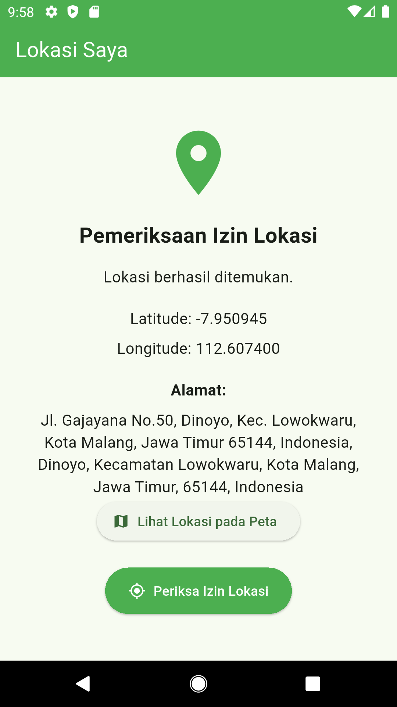
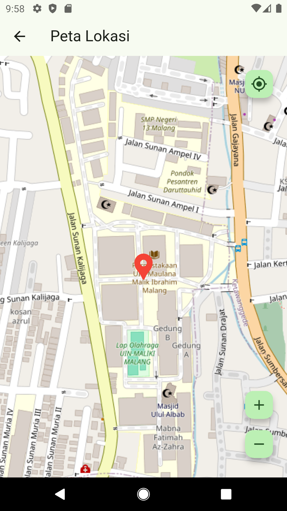

````md
# Aplikasi Lokasi Saya

Aplikasi **Lokasi Saya** merupakan aplikasi mobile berbasis Flutter yang digunakan untuk memperoleh dan menampilkan informasi lokasi perangkat. Aplikasi ini memanfaatkan layanan lokasi perangkat untuk mendapatkan koordinat geografis berupa latitude dan longitude, kemudian mengubah koordinat tersebut menjadi informasi alamat menggunakan proses *reverse geocoding*.

Selain menampilkan informasi alamat dan koordinat, aplikasi ini juga menyediakan tampilan peta untuk menunjukkan posisi perangkat secara visual. Peta dilengkapi dengan marker serta kontrol untuk memperbesar, memperkecil, dan mengembalikan tampilan ke lokasi awal.

## Fitur Aplikasi

Beberapa fitur yang tersedia dalam aplikasi ini meliputi:

- Memeriksa dan meminta izin akses lokasi perangkat.
- Mengambil koordinat geografis perangkat berupa latitude dan longitude.
- Mengubah koordinat menjadi informasi alamat menggunakan *reverse geocoding*.
- Menampilkan informasi alamat dan koordinat pada halaman utama.
- Menampilkan posisi perangkat pada peta.
- Menambahkan marker sebagai penanda lokasi perangkat.
- Menggeser dan memperbesar tampilan peta.
- Menyediakan tombol untuk memperbesar, memperkecil, dan mengembalikan tampilan peta ke lokasi awal.

## Screenshot Aplikasi

### Halaman Utama

Halaman utama menampilkan informasi lokasi perangkat, meliputi koordinat geografis dan alamat hasil proses *reverse geocoding*.



### Halaman Peta

Halaman peta menampilkan posisi perangkat menggunakan marker. Pengguna dapat menggeser dan mengatur pembesaran peta serta mengembalikan tampilan ke lokasi awal.



## Teknologi dan Package

Aplikasi ini dikembangkan menggunakan teknologi dan package berikut:

| Teknologi/Package | Kegunaan |
|---|---|
| Flutter | Framework untuk membangun aplikasi mobile. |
| Dart | Bahasa pemrograman yang digunakan dalam pengembangan aplikasi. |
| `geolocator` | Memeriksa izin akses lokasi dan mengambil koordinat geografis perangkat. |
| `geocoding` | Mengubah koordinat geografis menjadi informasi alamat melalui proses *reverse geocoding*. |
| `flutter_map` | Menampilkan peta dan elemen di atasnya, seperti marker lokasi. |
| `latlong2` | Menyediakan representasi koordinat geografis berupa latitude dan longitude. |
| OpenStreetMap | Menyediakan data peta yang ditampilkan dalam aplikasi. |

## Struktur Project

Struktur folder dan file utama aplikasi adalah sebagai berikut:

```text
lokasi_saya/
├── android/
├── ios/
├── lib/
│   ├── main.dart
│   ├── screens/
│   │   ├── home_screen.dart
│   │   ├── map_screen.dart
│   │   └── screenshots/
│   │       ├── Screenshot_002.png
│   │       └── Screenshot_003.png
│   └── services/
│       └── location_service.dart
├── pubspec.yaml
└── README.md
````

Keterangan:

* `main.dart`: Titik awal untuk menjalankan aplikasi.
* `screens/home_screen.dart`: Menampilkan informasi koordinat dan alamat perangkat.
* `screens/map_screen.dart`: Menampilkan peta dan posisi perangkat menggunakan marker.
* `services/location_service.dart`: Menangani pemeriksaan izin akses lokasi, pengambilan koordinat, dan proses *reverse geocoding*.
* `screenshots/`: Menyimpan gambar hasil implementasi aplikasi.

## Cara Menjalankan Aplikasi

### 1. Clone Repository

Unduh project dari GitHub menggunakan perintah:

```bash
git clone https://github.com/username/lokasi_saya.git
```

Ganti `username` dengan username GitHub pemilik repository.

### 2. Masuk ke Direktori Project

```bash
cd lokasi_saya
```

### 3. Install Dependencies

Jalankan perintah berikut untuk mengunduh package yang dibutuhkan:

```bash
flutter pub get
```

### 4. Jalankan Aplikasi

Pastikan perangkat Android atau emulator sudah terhubung, kemudian jalankan:

```bash
flutter run
```

## Konfigurasi Izin Akses Lokasi

Aplikasi memerlukan izin akses lokasi agar dapat memperoleh koordinat geografis perangkat. Pada Android, deklarasi izin ditambahkan ke file `AndroidManifest.xml` yang berada di direktori `android/app/src/main/`.

Tambahkan deklarasi berikut di dalam elemen `<manifest>`:

```xml
<uses-permission android:name="android.permission.ACCESS_COARSE_LOCATION" />
<uses-permission android:name="android.permission.ACCESS_FINE_LOCATION" />
<uses-permission android:name="android.permission.INTERNET" />
```

Selain deklarasi tersebut, aplikasi juga meminta izin akses lokasi kepada pengguna saat dijalankan.

## Sumber Data Peta

Data peta dalam aplikasi ini menggunakan **OpenStreetMap**. Tampilan peta diintegrasikan ke dalam aplikasi menggunakan package `flutter_map`.

Data peta OpenStreetMap dapat diakses melalui:

https://www.openstreetmap.org/

## Lisensi

Project ini dikembangkan sebagai bahan pembelajaran pemrograman mobile menggunakan Flutter dan Dart.

```

Sebelum diunggah, ganti `username` pada alamat repository dan pastikan lokasi kedua file screenshot sesuai dengan struktur folder yang tercantum.
```
